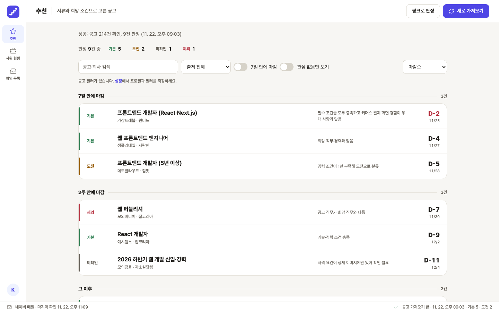
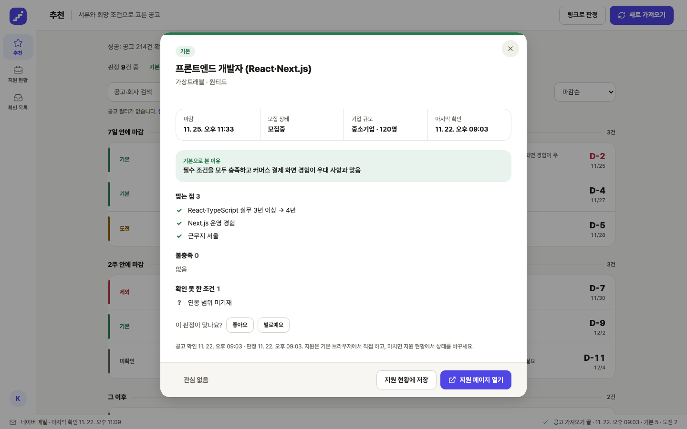
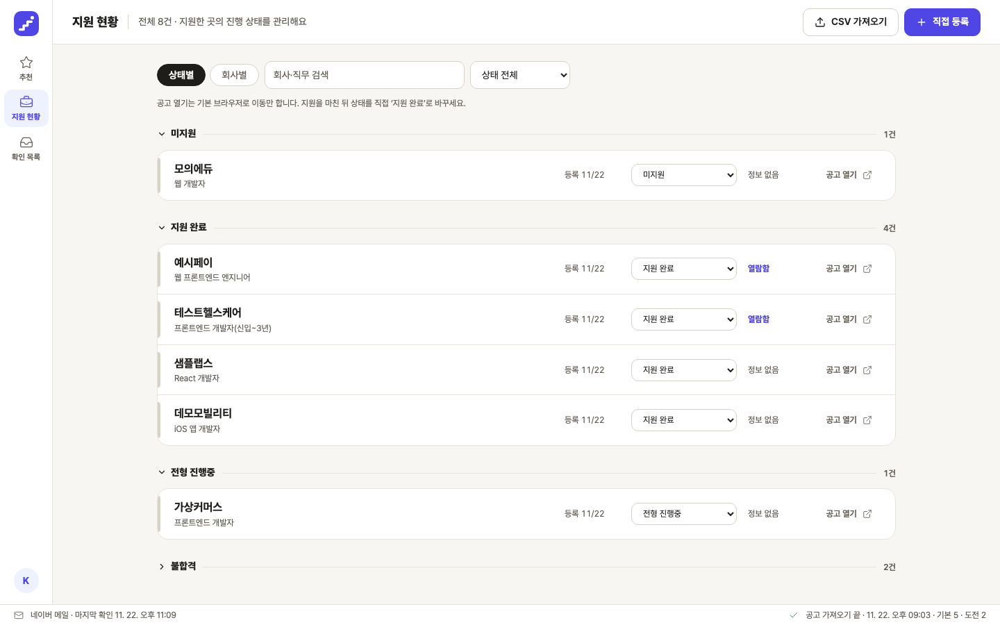
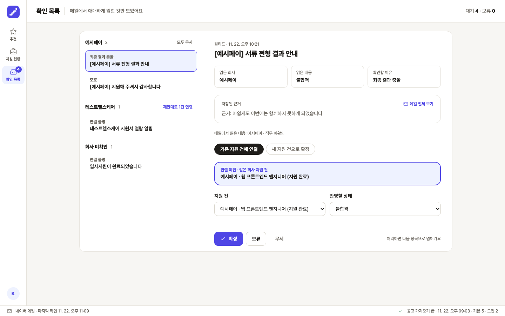
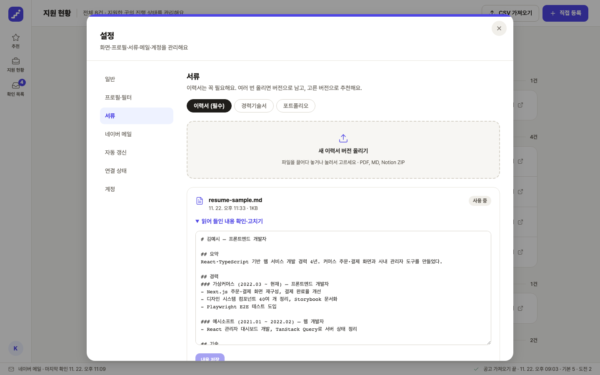
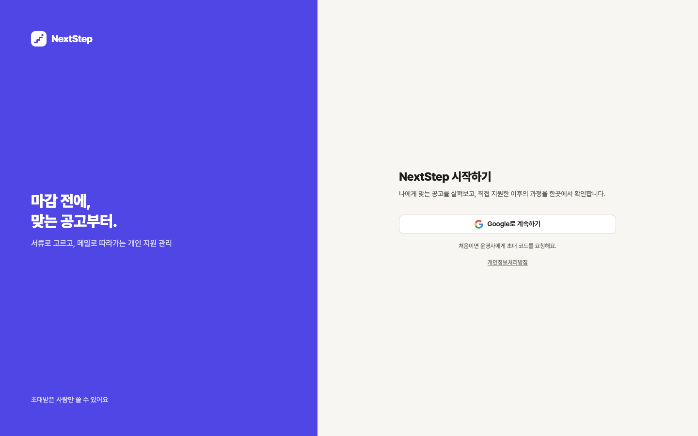

  

# NextStep

> 내 서류에 맞는 채용공고를 골라 주고, 지원 이후의 진행 상황까지 한곳에서 챙겨 주는 취업·이직 준비 도우미

취업·이직을 준비하면 여러 채용 사이트를 매일 돌며 공고를 고르고, 지원한 회사의 서류 결과는 메일함과 사이트를 오가며 따로 확인해야 한다. NextStep은 이력서·경력기술서·포트폴리오와 희망 조건을 바탕으로 다섯 채용 사이트의 공고를 모아 내게 맞는 정도와 근거를 함께 보여 주고, 지원한 뒤에는 채용 메일을 읽어 접수·열람·결과를 지원 현황에 반영한다. 지원 자체는 사용자가 직접 하고, NextStep은 무엇에 지원할지와 어디까지 진행됐는지를 정리하는 데 집중한다.

운영자가 홈서버에서 직접 운영하는 비공개 서비스로, 운영자와 초대받은 사용자만 구글 로그인과 초대 코드로 쓴다.

## 화면

> 아래 화면은 임시 DB에 가상의 회사·공고·메일로 만든 예시다.

  
  

추천: 마감이 가까운 순으로 묶은 공고(왼쪽)와 판정 근거를 보여 주는 상세 창(오른쪽)

  
  

지원 현황: 상태별 묶음과 줄 안 상태 변경(왼쪽) · 확인 목록: 회사별 대기열과 메일 근거, 연결 제안(오른쪽)

  
  

설정: 이력서 등록과 읽어 들인 내용 확인(왼쪽) · 구글 로그인과 초대 코드로 시작하는 첫 화면(오른쪽)

## 주요 기능

### 맞춤 공고 추천

- **네 곳의 공고를 한 번에**: 사람인·잡코리아·원티드·점핏(개발 직무)에서 내 직무에 맞는 공고를 모아 온다. 같은 공고가 여러 곳에 올라와도 한 번만 보여 준다.
- **근거가 있는 추천**: 공고마다 기본·도전·미확인·제외로 나누고 왜 그렇게 판단했는지 근거를 함께 보여 준다.
- **마감 순으로 정리**: 7일 안·2주 안·그 이후·상시·마감 미확인으로 묶어 급한 공고부터 볼 수 있다.
- **링크 한 건 판정**: 따로 찾은 공고 링크를 넣으면 그 공고 하나가 나와 맞는지 바로 확인한다.
- **내 취향 반영**: 좋아요·별로·관심 없음으로 추천을 다듬고, 잘못 제외한 공고는 다시 되살린다. 출처·마감 임박·정렬 같은 보기 조건은 기억해 둔다.
- **지원은 내가 직접**: 공고 열기는 기본 브라우저로 이동만 하고, 지원할 공고는 지원 현황에 저장해 둔다.

### 서류와 희망 조건

- **서류 등록**: 이력서(필수)와 경력기술서·포트폴리오(선택)를 끌어다 놓으면 바로 올라간다. PDF·Markdown·Notion 내보내기(ZIP)를 모두 읽고, 이미지로 된 쪽은 글자 인식으로 읽어 들인다.
- **읽은 내용 확인**: 서류에서 읽어 들인 내용을 직접 확인하고 고칠 수 있다.
- **버전 관리**: 종류마다 최근 10개 버전을 남겨 두고, 추천에 쓸 버전을 고르거나 이전 버전으로 되돌린다.
- **프로필·필터**: 서류를 바탕으로 프로필과 희망 조건 초안을 만들어 주고, 확인한 뒤 저장한다.

### 지원 현황 관리

- **지원 현황판**: 지원한 공고를 상태별·회사별로 묶어 보고, 줄 안에서 바로 상태를 바꾼다. 불합격 묶음은 처음에 접어 둔다.
- **직접 등록과 가져오기**: 공고를 직접 등록하거나 기존에 쓰던 지원 현황을 CSV로 한 번에 가져온다.
- **변경 이력**: 상태·열람 여부를 언제 어떻게 바꿨는지 기록이 남고, 메일이 바꾸지 못하도록 잠글 수도 있다.

### 채용 메일 자동 반영

- **네이버 메일 연결**: 애플리케이션 비밀번호로 메일함을 읽기 전용으로 연결한다. 메일을 보내거나 읽음 표시를 바꾸지 않는다.
- **진행 상황 자동 반영**: 매시간 채용 메일을 확인해 접수·열람·서류 결과를 해당 지원 건에 반영한다. 이미 진행된 상태를 오래된 메일로 되돌리지 않는다.
- **확인 목록**: 어느 지원 건인지 애매하거나 결과가 충돌하는 메일은 회사별 확인 목록에 모아 근거와 함께 보여 주고, 사용자가 연결·보류·처리를 고른다.

### 자동 갱신과 알림

- **매일 자동 갱신**: 자동 갱신을 켜 두면 서버가 매일 저녁 한 번 공고를 새로 가져오고 매시간 메일을 확인한다. 앱이나 브라우저를 닫아도 서버에서 계속 돈다.
- **진행 상태 표시**: 화면 아래 상태바에서 메일 마지막 확인 시각과 공고 갱신 결과(진행 중이면 진행 정도와 남은 시간)를 볼 수 있다.
- **데스크톱 알림 앱**: macOS 메뉴 막대·Windows 알림 영역에 상주하며 공고 갱신이 끝나면 운영체제 알림으로 알려 준다.

### 개인정보 보호

- **서버 안에서만 처리**: 서류·공고·메일 분석은 홈서버 안의 AI가 처리하며 외부 AI 서비스로 보내지 않는다.
- **필요한 것만 저장**: 공고 원문과 메일 본문은 저장하지 않는다. 메일 전체 보기는 열 때만 메일함에서 읽어 온다.
- **계정 분리**: 사용자마다 자료가 분리되며, 계정을 삭제하면 서류와 기록이 함께 지워진다.

## 현재 구현 범위

위 기능은 모두 동작하는 상태로 운영자가 직접 쓰면서 다듬고 있다. 백엔드·QA 직무와 점핏 공고의 실제 추천 흐름, 데스크톱 앱의 Windows 실행은 아직 확인하지 않았다. 세부 구현 범위는 [개발 가이드](docs/DEVELOPMENT.md#현재-구현-범위), 단계별 진행 상태는 [백로그](docs/spec/백로그.md)에서 관리한다.

## 기술 스택

**Web**

     

**Server**

    

**Desktop**

**Tooling·Infra**

    

## 개발 문서

- [개발 가이드](docs/DEVELOPMENT.md): 설치와 실행, 명령, 환경과 데이터, 검증, 세부 구현 범위
- [서비스 기획서](docs/spec/서비스기획서.md): 요구·범위·완료 조건
- [기술 설계](docs/spec/기술설계.md): 데이터·작업·보호 설계
- [백로그](docs/spec/백로그.md): 구현 순서와 진행 상태
- [기술 규칙](TECH_RULES.md)·[에이전트 작업 규칙](AGENTS.md): 기술 선택과 작업 규칙
